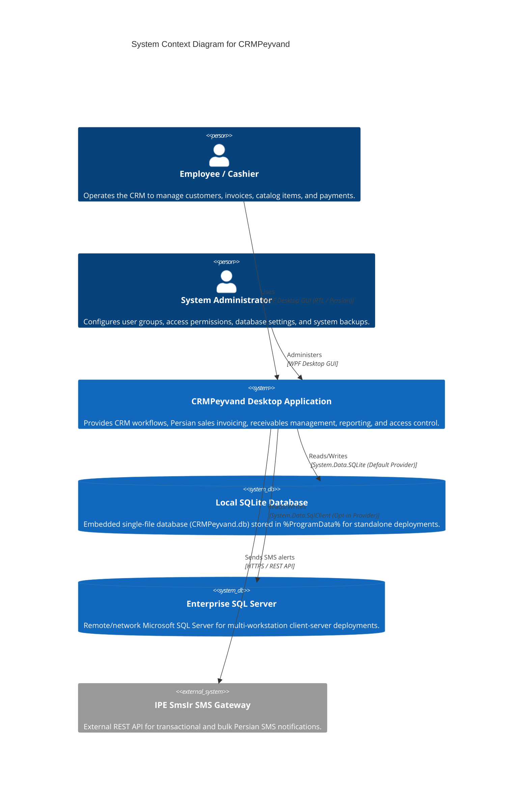
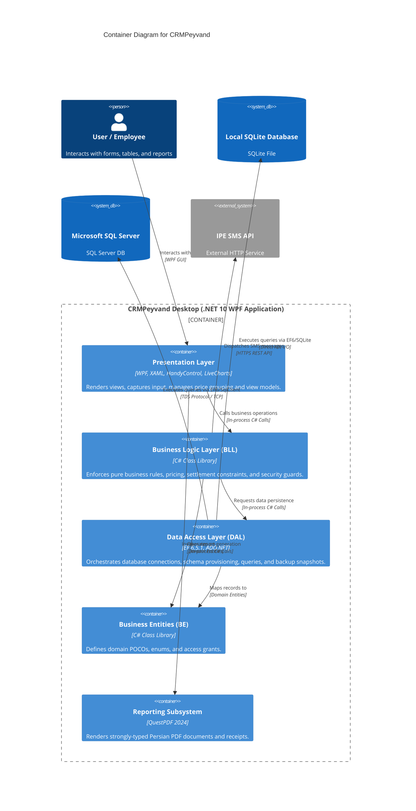
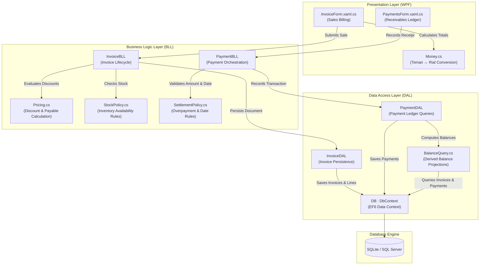
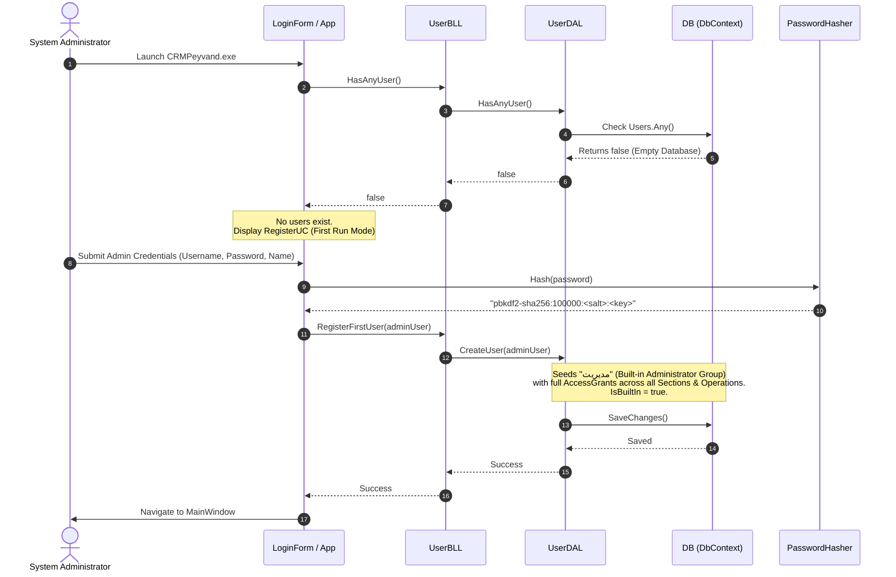
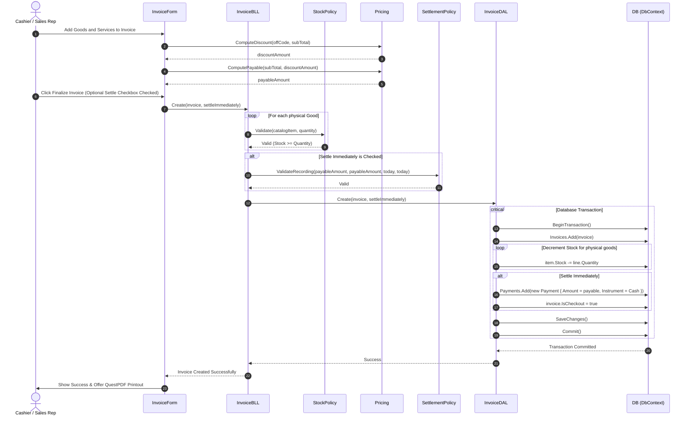
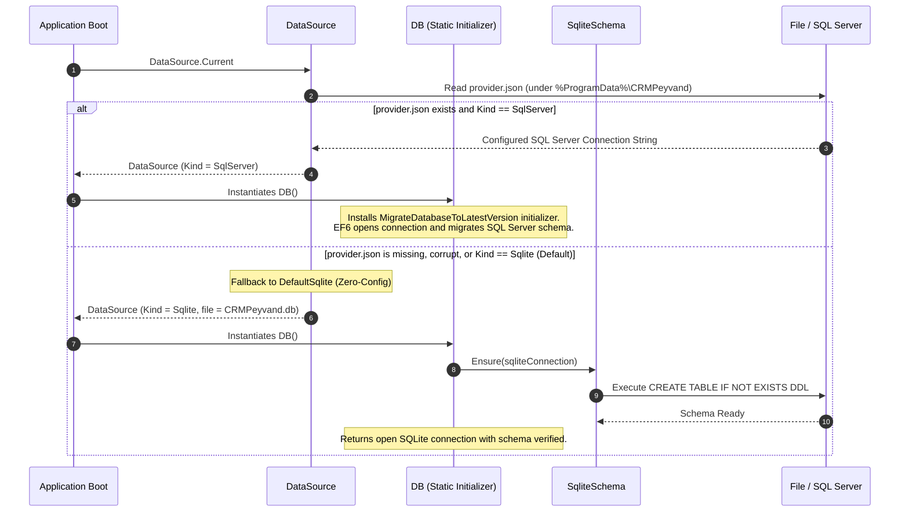

# C4 Architectural Model & Dynamic Interaction Diagrams

This document details the architectural structure of **CRMPeyvand** following the **C4 Model** (Context, Containers, Components) and provides dynamic Mermaid sequence diagrams illustrating core runtime workflows.

---

## 1. C4 Level 1: System Context Diagram

The System Context diagram illustrates how CRMPeyvand fits into the overall operational environment, depicting users and external dependencies.

---

## 2. C4 Level 2: Container Diagram

The Container diagram zooms into the CRMPeyvand desktop executable and shows its internal boundary partitions and external integration points.

---

## 3. C4 Level 3: Component Diagram (Sales & Receivables Subsystem)

This diagram breaks down the sales, invoicing, and receivables management subsystem into its collaborating classes.

---

## 4. Dynamic Runtime Workflows

### 4.1 First Run & Administrator Seeding Workflow

On first launch, CRMPeyvand detects whether any user account exists. If none are found, it guides the operator through initial system administrator onboarding.

---

### 4.2 Invoice Issuance & Payment Settlement Workflow

This sequence demonstrates issuing an invoice, decreasing inventory, and settling the balance authoritatively.

---

### 4.3 Dual-Database Provider Initialization & Fallback Workflow

CRMPeyvand determines the active database engine at startup through `DataSource.Current`. If the configured provider encounters an irrecoverable error, it fails gracefully.

