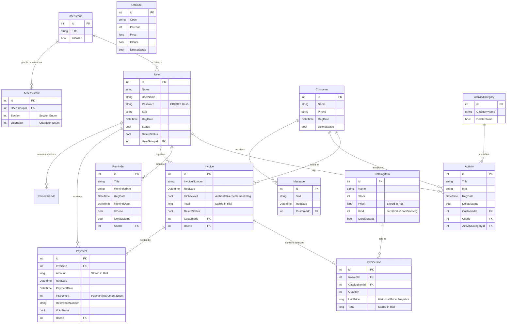

# Data & Storage Architecture

## 1. Overview & Architectural Goals

CRMPeyvand supports **Dual-Database Mode** ([ADR-0008](../adr/0008-dual-database-mode.md)), allowing the application to operate interchangeably against:
1. **SQLite (Default)**: Embedded, single-file zero-configuration database (`CRMPeyvand.db`). Enables instant installation and execution without installing any database server software.
2. **Microsoft SQL Server (Opt-in)**: Network database supporting concurrent multi-user deployments across local area networks.

Both database engines run behind a **single Data Access Layer (`DAL`)** and share identical Entity Framework 6 domain entities (`BE`).

---

## 2. Provider Architecture & Lifecycle

The provider lifecycle is governed by two core components: `DAL.DataSource` and `DAL.DB`.

```
┌────────────────────────────────────────────────────────┐
│                      DataSource                        │
│   Manages provider.json • Retains fallback settings    │
│   Resolves storage paths • Builds Connection Strings   │
└───────────────────────────┬────────────────────────────┘
                            │ resolves connection
                            ▼
┌────────────────────────────────────────────────────────┐
│                   DB (DbContext)                       │
│    Registers SqliteConfiguration on .NET 10 runtime    │
│   Handles Schema Ensure (SQLite) vs Migration (MSSQL)  │
└───────────────────────────┬────────────────────────────┘
               ┌────────────┴────────────┐
               ▼                         ▼
   ┌───────────────────────┐ ┌───────────────────────┐
   │    SQLite Provider    │ │  SQL Server Provider  │
   │  System.Data.SQLite   │ │ System.Data.SqlClient │
   │ Connection state: OPEN│ │Connection state: CLOSE│
   │  DDL: SqliteSchema    │ │ DDL: EF6 Migrations   │
   └───────────────────────┘ └───────────────────────┘
```

### 2.1 Provider Configuration Storage (`provider.json`)

The active provider and connection settings are stored in `provider.json` inside the shared application data folder (`%ProgramData%\CRMPeyvand` or fallback `%LocalAppData%\CRMPeyvand` via `DataFolder.Resolve()`).

```json
{
  "Kind": "Sqlite",
  "ConnectionString": "Data Source=C:\\ProgramData\\CRMPeyvand\\CRMPeyvand.db;DateTimeFormat=ISO8601",
  "SqlServerConnectionString": "Data Source=.;Initial Catalog=PeyvandCRM;Integrated Security=True;Encrypt=False"
}
```

#### Key Design Decisions:
- **Reversible Switching**: `SqlServerConnectionString` is preserved even when SQLite is active. Users can toggle back and forth in the settings UI without re-typing connection strings.
- **Fail-Safe Startup**: If `provider.json` is missing or corrupted, `DataSource.Load()` catches exceptions and defaults to SQLite. The app will never fail to boot due to an invalid configuration file.
- **Single Process Lock**: `DataSource.Current` resolves once behind an internal lock (`object Gate`).

---

## 3. Runtime Plumbing & EF6 Quirks on .NET 10

Running Entity Framework 6 on the modern **.NET 10** runtime requires explicit handling of assembly decoupling and provider registration:

### 3.1 Code-Based Provider Registration
On modern .NET, `<system.data>` configuration in `App.config` does not reliably resolve provider factories because `System.Data.Common` is loaded from a separate runtime assembly. `DAL.DB` registers SQLite programmatically in its static constructor:

```csharp
DbConfiguration.SetConfiguration(new SqliteConfiguration());

private sealed class SqliteConfiguration : DbConfiguration
{
    public SqliteConfiguration()
    {
        SetProviderFactory(SqliteSchema.Invariant, SQLiteFactory.Instance);
        SetProviderServices(
            SqliteSchema.Invariant,
            (DbProviderServices)Activator.CreateInstance(Type.GetType(
                "System.Data.SQLite.EF6.SQLiteProviderServices, System.Data.SQLite.EF6",
                throwOnError: true)));
    }
}
```

### 3.2 Provider Factory & Type Casting
EF6 SQL Server provider services hard-cast to `System.Data.SqlClient.SqlConnection`. Passing a `Microsoft.Data.SqlClient.SqlConnection` causes runtime `NotSupportedException` or `InvalidCastException`.
- `DataSource.CreateConnection` explicitly returns `System.Data.SqlClient.SqlConnection` when connecting to SQL Server.
- `Microsoft.Data.SqlClient` is used strictly for standalone operations, such as the SQL Server connection probe.

### 3.3 Connection Open States
- **SQLite connections are returned OPEN**: `SqliteSchema.Ensure` executes DDL upon opening to guarantee tables exist before any LINQ query executes.
- **SQL Server connections are returned CLOSED**: Handed to EF6 in a closed state to allow `MigrateDatabaseToLatestVersion<DB, Migrations.Configuration>` to open and migrate the schema.

---

## 4. Backup, Restore, and Data Recovery

The backup and recovery mechanisms are implemented in `DAL.SettingDAL`.

### 4.1 SQLite Online Backup API
Standard file copying (`File.Copy`) on an active SQLite file risks capturing an inconsistent state during write transactions. CRMPeyvand invokes SQLite's native **Online Backup API**:

```csharp
using (var sourceConnection = new SQLiteConnection(connectionString))
{
    sourceConnection.Open();
    using (var destination = new SQLiteConnection(destConnectionString))
    {
        destination.Open();
        // Page count -1 copies entire database in one atomic non-blocking call
        sourceConnection.BackupDatabase(destination, "main", "main", -1, null, 0);
    }
}
```
**Advantage**: The source database remains open and accessible; users can continue issuing invoices and creating customers while the backup is being saved.

### 4.2 SQL Server Native Backup
On SQL Server, `SettingDAL` executes a parameterized native command:
```sql
BACKUP DATABASE [@DatabaseName] TO DISK = @path WITH INIT
```

### 4.3 Soft-Delete Recovery System
Entities implement a soft-delete pattern via `DeleteStatus` (`bool`). The `SettingDAL.Recovery()` method provides an administrative recovery operation that flips `DeleteStatus = false` across all tables (`Customers`, `Invoices`, `CatalogItems`, `Activities`, etc.) in a single transaction.

---

## 5. Entity-Relationship Model (ERD)

The complete domain model and relational schema across both SQLite and SQL Server:


