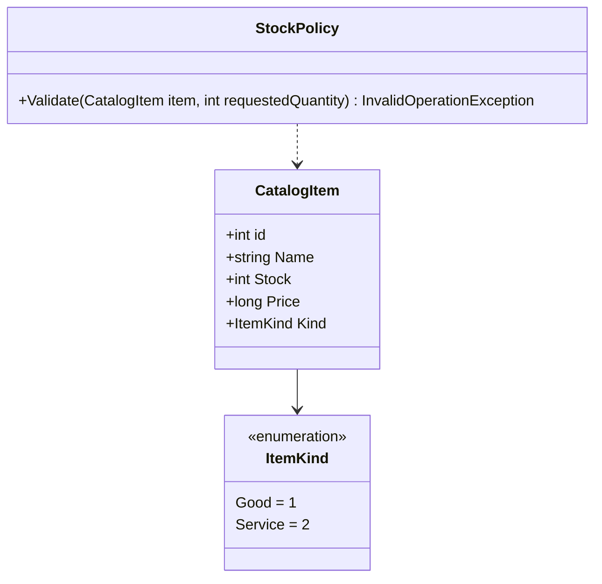

# Domain & Business Logic Architecture

## 1. Domain Design Philosophy

The business logic in CRMPeyvand follows a **pure policy pattern**:
- **Stateless Domain Rules**: Core business policies (`Pricing`, `StockPolicy`, `SettlementPolicy`) are isolated into static, side-effect-free methods.
- **Independence from Persistence & UI**: Domain rules have zero dependencies on WPF, XAML, or Entity Framework `DbContext`. They accept primitive arguments or domain entities and return validation outcomes or computed results.
- **High Testability**: Policies are tested extensively via unit tests (`CRMPeyvand.Tests`) without mocking databases or spawning UI threads.

---

## 2. The Dual-Currency Architecture (Rial vs. Toman)

One of the most critical aspects of Iranian commercial software is handling the two prevailing currency denominations: **Rial (ریال)** and **Toman (تومان)**.

```
┌────────────────────────────────────────────────────────┐
│                   Database & Reports                   │
│                     BASE UNIT: RIAL                    │
│   • Exact integer persistence in database records      │
│   • Printed on external fiscal documents & receipts    │
└───────────────────────────▲────────────────────────────┘
                            │
               Money.FromToman(toman)  [Exact: * 10]
               Money.ToToman(rial)     [Floored: / 10]
                            │
┌───────────────────────────▼────────────────────────────┐
│                  Presentation Layer                    │
│                    DISPLAY: TOMAN                      │
│   • User-facing textboxes, data grids, and cards       │
│   • Grouped with thousands separators (e.g. 50,000)    │
│   • Floor division prevents displaying money not held  │
└────────────────────────────────────────────────────────┘
```

### 2.1 The Two Rules
1. **Rial is what is stored and printed**:
   - In database columns (`Total`, `Price`, `Amount`, `UnitPrice`), money is stored as Rial.
   - External printable documents (QuestPDF invoices, payment receipts, customer debtor statements) print in Rial (`ریال`). This satisfies tax, audit, and formal accounting standards.
2. **Toman is what the screens show and users type**:
   - Every input field and DataGrid cell displays Toman (`تومان`), which is one-tenth of Rial ($1\text{ Toman} = 10\text{ Rial}$).
   - `Money.ToToman(rial)` uses **floor division** (`Math.Floor(rial / 10m)`). Rial do not always divide evenly; flooring ensures the screen never displays an amount greater than the backing balance.
   - `Money.FromToman(toman)` multiplies by 10 (`toman * 10m`). Multiplying on save is exact and loses nothing.

### 2.2 Live Input Formatting (`PriceField.cs`)
When employees enter prices in forms:
- `PriceField` automatically formats digits with thousand separators on each keystroke (`100000` $\rightarrow$ `100,000`).
- Caret positions are calculated so the cursor stays anchored to the digit being edited rather than jumping to the end.
- Separators are stripped before persistence.

---

## 3. Inventory & Catalog Policies (`StockPolicy.cs`)

CRMPeyvand differentiates between physical goods and non-physical services via the `ItemKind` enum:



### Inventory Validation Rules
- **Services (`ItemKind.Service`)**: Represent non-physical items (e.g., consulting, maintenance, labor). Services bypass inventory checks entirely (`Validate` returns `null`).
- **Goods (`ItemKind.Good`)**: Represent physical items with tracked inventory.
  - Requested quantity must be greater than zero.
  - If `item.Stock < requestedQuantity`, an `InvalidOperationException` is raised: `"موجودی انبار کافی نمیباشد : <ItemName>"`.
- **Automatic Stock Decrement**: On invoice finalization, `InvoiceBLL` decrements `CatalogItem.Stock` by the line item quantity within the same database transaction.

---

## 4. Invoicing & Pricing Arithmetic (`Pricing.cs`)

Discount calculations and payable totals are strictly computed through `BLL.Pricing`:

```csharp
public static class Pricing
{
    public static decimal ComputeDiscount(OffCode off, decimal subTotal)
    {
        if (off == null || subTotal <= 0) return 0m;
        if (off.IsPrice) return Math.Min(off.Price ?? 0m, subTotal);
        var percent = off.Percent ?? 0;
        return decimal.Floor(subTotal * percent / 100m);
    }

    public static decimal ComputePayable(decimal subTotal, decimal discountAmount)
    {
        var payable = subTotal - discountAmount;
        return payable < 0m ? 0m : payable;
    }
}
```

### Key Guarantees
- **No Negative Payable**: Payable amounts cannot drop below zero even if a discount exceeds the total.
- **Percentage Discounts Floored**: Calculated discount percentages are floored to whole currency units.

---

## 5. Receivables & Settlement Engine (`SettlementPolicy.cs`)

In accordance with [ADR-0009](../adr/0009-payments-authoritative-over-checkout-flag.md), payments are the authoritative financial ledger of transactions.

### 5.1 Payment Validation Constraints
When recording a payment against an invoice, `SettlementPolicy.ValidateRecording` enforces three critical invariants:

```
1. Amount > 0
   └─ Rejects negative or zero payment entries ("مبلغ وصولی باید بیشتر از صفر باشد")

2. Date <= Today
   └─ Rejects post-dated receipts ("تاریخ وصولی نمیتواند در آینده باشد")

3. Amount <= Outstanding Balance
   └─ Rejects overpayment ("مبلغ وصولی نمیتواند بیشتر از مانده حساب فاکتور باشد")
```

### 5.2 Outstanding Balance Calculation (`BalanceQuery.cs`)
The outstanding balance of an invoice is derived dynamically from its non-voided payments:

$$\text{Outstanding Balance} = \text{Invoice Total} - \sum_{\substack{p \in \text{Payments} \\ \neg p.\text{VoidStatus}}} p.\text{Amount}$$

- **Invoice Settled Status (`IsCheckout`)**: Derived from the payment balance. When the outstanding balance reaches zero, the invoice is considered fully settled.
- **Counter Settlement**: If the cashier checks «تسویه کامل» (Settle in Full) when issuing an invoice, `InvoiceDAL` records a payment for the full payable amount within the same transaction that writes the invoice.
- **Immutable Receipts / Voiding**: Payments are never modified or deleted. If an error occurs, the payment is marked `VoidStatus = true` and a new payment is issued, preserving printed receipt traceability.
