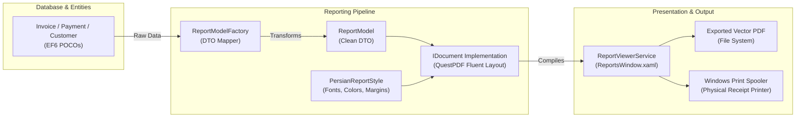

# Reporting Subsystem Architecture

## 1. Overview & Architectural Goals

The reporting subsystem in CRMPeyvand generates vector-quality, printable PDF documents and preview dialogs for sales invoices, customer statements, financial receipts, and audit logs.

In accordance with [ADR-0007](../adr/0007-questpdf-reporting-engine.md), the system uses **QuestPDF 2024** instead of legacy binary report designers (such as Stimulsoft `.mrt` files).

### Core Benefits of the Typed C# Reporting Pipeline:
- **Source-Controlled Layouts**: Reports are defined entirely in standard C# code (`IDocument`), making layout adjustments reviewable via standard git diffs.
- **Strong Typing**: Compile-time verification of model properties eliminates runtime data-binding exceptions.
- **Embedded Persian RTL Layout**: Native Right-to-Left text flow without relying on external system fonts or COM report runtimes.
- **Fast Execution**: Pure in-memory generation with zero disk I/O for preview caching.

---

## 2. Subsystem Architecture & Data Flow

The reporting engine follows a structured **Model-Factory-Document-Viewer** pipeline:



---

## 3. Typography & RTL Layout Standards (`PersianReportStyle.cs`)

Persian financial documents require strict RTL alignment, specialized date formatting, and clear visual hierarchies. `PersianReportStyle` encapsulates these design rules:

### 3.1 Color Palette & Theme Tokens
```csharp
public static class PersianReportStyle
{
    public const string PrimaryColorHex = "#1E293B";   // Slate 800 (Headers & Dominant Text)
    public const string AccentColorHex = "#2563EB";    // Blue 600 (Primary Accents & Badges)
    public const string MutedColorHex = "#64748B";     // Slate 500 (Labels & Subtitles)
    public const string BorderColorHex = "#E2E8F0";    // Slate 200 (Table Grids & Outlines)
    public const string ZebraBgHex = "#F8FAFC";        // Slate 50 (Alternating Row Background)
    public const string DarkBgHex = "#0F172A";         // Slate 900 (High-Contrast Headers)
    public const string SuccessColorHex = "#16A34A";   // Green 600 (Paid Indicators)
}
```

### 3.2 Font Selection & RTL Text Direction
- **Primary Font**: `Tahoma` (standard Windows font with complete Persian glyph coverage and sharp rendering at small sizes).
- **Secondary & Fallback**: `Segoe UI`, `Vazirmatn`, `Arial`.
- **RTL Container Wrapping**: Every document wraps root page elements inside `.ContentFromRightToLeft()`.

---

## 4. Document Catalog

All printable documents reside in `CRMPeyvand/Reports/Documents/` and implement QuestPDF's `IDocument`:

| Document | File | Purpose | Key Content Elements |
|---|---|---|---|
| **Sales Invoice** | `InvoiceDocument.cs` | Formal customer sales invoice. | Customer profile, invoice number, Persian issue date, itemized table with line totals, discount breakdown, net payable, and cashier signature block. |
| **Payment Receipt** | `PaymentReceiptDocument.cs` | Printed proof of payment (`رسید دریافت`). | Payment date, reference number, tender instrument (cash/card/transfer), amount paid, and invoice outstanding balance remainder. |
| **Customer Balances** | `CustomerBalanceDocument.cs` | Accounts receivable debtor report (`مانده حساب`). | List of all customers carrying unpaid balances, total invoiced, total payments received, and net balance owed. |
| **Sales Summary** | `SalesSummaryDocument.cs` | Aggregate revenue audit report. | Date range filters, total revenue, discount totals, net collections, and top-selling catalog items. |
| **Customer List** | `CustomerListDocument.cs` | Customer directory printout. | Names, phone contacts, registration dates, and active activity counts. |
| **Catalog Item List** | `CatalogItemListDocument.cs` | Inventory audit report. | Item titles, category grouping, unit prices, kind (Good vs. Service), and available stock. |
| **Activity Log** | `ActivityListDocument.cs` | Customer relationship history. | Logged interactions, categories, responsible employees, and resolution status. |

---

## 5. Currency & Number Formatting Rules in Documents

Financial reporting follows the system's core currency rule:
- **Amounts are printed in Rial (ریال)**: Because reports represent formal external documents and accounting audits, all figures are printed using the base database integer without Toman division.
- **Thousand Separators**: Formatted via `PersianReportStyle.FormatMoney(amount)` or standard Persian culture formatting (`amount.ToString("N0") + " ریال"`).
- **Persian Dates**: Formatted with full Persian Solar calendar strings (e.g., `1405/08/07`).

---

## 6. Preview and Printing Architecture (`ReportViewerService.cs`)

When a user requests a print or preview:
1. The appropriate `ReportModelFactory` maps EF6 entities into a lightweight DTO (e.g. `InvoiceReportModel`).
2. An instance of `IDocument` is constructed with the model.
3. `ReportViewerService.ShowReport(windowTitle, document)` renders the document to a byte stream and displays it in `ReportsWindow.xaml`.
4. `ReportsWindow` provides:
   - Live vector zoom and multi-page navigation.
   - One-click print sending directly to the default Windows printer.
   - One-click PDF export opening a native `SaveFileDialog`.
