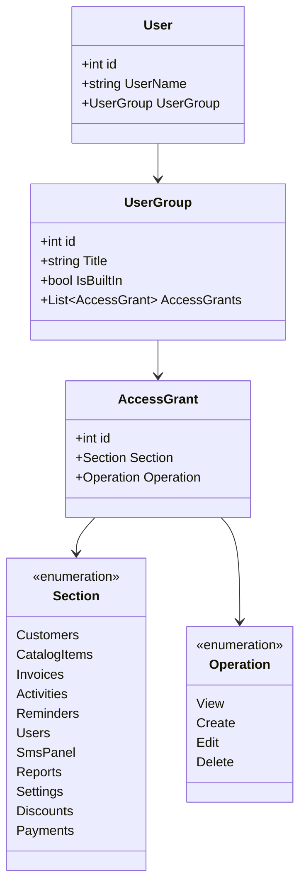
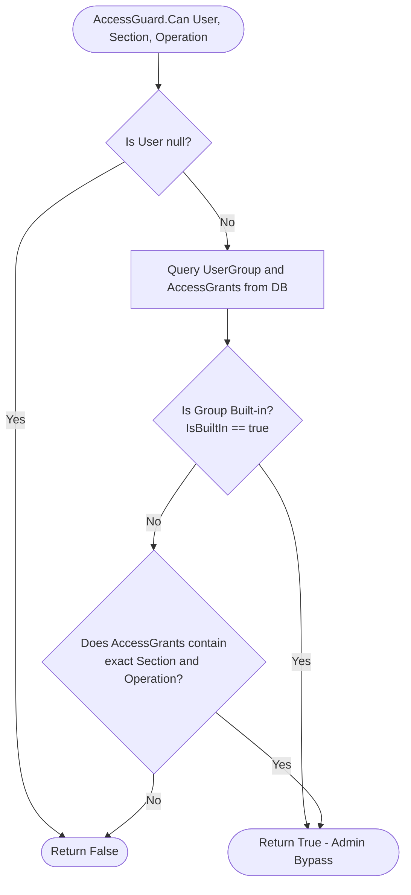

# Security & Access Control (RBAC) Architecture

## 1. Security Overview

CRMPeyvand implements an enterprise-grade security architecture designed around three core pillars:
1. **Cryptographically Secure Authentication**: Passwords stored using industry-standard salted PBKDF2-SHA256 with constant-time verification ([ADR-0005](../adr/0005-pbkdf2-password-hashing.md)).
2. **Granular Role-Based Access Control (RBAC)**: Strongly-typed permission matrix spanning 11 functional sections and 4 CRUD operations ([ADR-0003](../adr/0003-typed-permission-matrix.md)).
3. **Protected Built-in Administrator Group**: Tamper-proof system administrator role seeded on First Run with guaranteed bypass privileges ([ADR-0006](../adr/0006-built-in-administrator-group.md)).

---

## 2. Authentication & Password Cryptography

### 2.1 Password Hashing Specification (`PasswordHasher.cs`)
Password hashing adheres to **RFC 2898** using PBKDF2 with HMAC-SHA256:

| Parameter | Specification | Purpose |
|---|---|---|
| **Algorithm** | PBKDF2 (HMAC-SHA256) | High resistance to GPU/ASIC brute-force attacks |
| **Iteration Count** | 100,000 rounds | Sufficient work factor for modern desktop hardware |
| **Salt Size** | 16 bytes (128 bits) | Cryptographically secure pseudo-random per-user salt |
| **Key Size** | 32 bytes (256 bits) | 256-bit derived key |
| **Encoding Format** | `pbkdf2-sha256:100000:<salt-base64>:<key-base64>` | Self-describing hash string supporting future versioning |

### 2.2 Constant-Time Verification
Verification checks candidate passwords using constant-time comparison to protect against side-channel timing analysis:

```csharp
private static bool SlowEquals(string left, string right)
{
    uint diff = (uint)left.Length ^ (uint)right.Length;
    for (int i = 0; i < left.Length && i < right.Length; i++)
        diff |= (uint)(left[i] ^ right[i]);
    return diff == 0;
}
```

### 2.3 Session Persistence (`RememberMe`)
When an employee checks «مرا به خاطر بسپار» (Remember Me) on login:
1. The app generates a cryptographically random token string.
2. The token is saved in the `RememberMe` database table with a 30-day expiration window.
3. On application boot, `LoginForm` inspects the local token. If valid and not expired, the user is authenticated directly into `MainWindow`.

---

## 3. Granular Role-Based Access Control (RBAC)

CRMPeyvand rejects coarse string-based role flags in favor of a **strongly-typed Permission Matrix**:

$$\text{Permission} = \text{Section} \times \text{Operation}$$



### 3.1 Matrix Definitions

#### Protected Sections (`BE.Section`)
1. `Customers`: Customer directory, contact cards, and notes.
2. `CatalogItems`: Goods and Services catalog, stock counts, and prices.
3. `Invoices`: Sales invoice creation, line items, and print preview.
4. `Activities`: Customer call logs, meetings, and follow-ups.
5. `Reminders`: Task scheduling and alert dispatching.
6. `Users`: Employee account creation, credentials, and password resets.
7. `SmsPanel`: SMS provider account configuration and SMS broadcasting.
8. `Reports`: QuestPDF sales summaries, financial balance sheets, and lists.
9. `Settings`: Database configuration, backup snapshot, and data recovery.
10. `Discounts`: Promotional discount codes and coupon rules.
11. `Payments`: Cashier ledger, payment recording, and payment voiding.

#### Protected Operations (`BE.Operation`)
- `View`: Permission to open screens and read records.
- `Create`: Permission to insert new records.
- `Edit`: Permission to update existing records.
- `Delete`: Permission to soft-delete or void records.

---

## 4. Permission Evaluation Pipeline

Permission evaluation is decoupled into two components:
1. `BLL.AccessDecision`: Pure, stateless evaluation logic.
2. `BLL.AccessGuard`: High-level entry point resolving active database permissions.



### 4.1 Pure Decision Logic (`AccessDecision.cs`)
```csharp
public static class AccessDecision
{
    public static bool Evaluate(
        bool isBuiltIn,
        IEnumerable<AccessGrant> grants,
        Section section,
        Operation operation)
    {
        // 1. Built-in Administrator group has universal access
        if (isBuiltIn)
            return true;

        if (grants == null)
            return false;

        // 2. Strict match against explicit grants
        return grants.Any(g => g.Section == section && g.Operation == operation);
    }
}
```

### 4.2 The Built-in Administrator Group (`IsBuiltIn`)
As documented in [ADR-0006](../adr/0006-built-in-administrator-group.md):
- On **First Run**, the application creates a group named `مدیریت` with `IsBuiltIn = true`.
- The `IsBuiltIn` flag guarantees access across all present and future sections, even if new sections are added in later software upgrades.
- The UI explicitly disables deleting or editing permissions for any group where `IsBuiltIn == true`, preventing accidental administrator lockout.
- Cashier-safe roles (e.g. `صندوقدار`) can be granted `Payments.Create` and `Payments.View` without granting `Invoices.Create` or `CatalogItems.Edit`, preventing unauthorized inventory manipulations.
